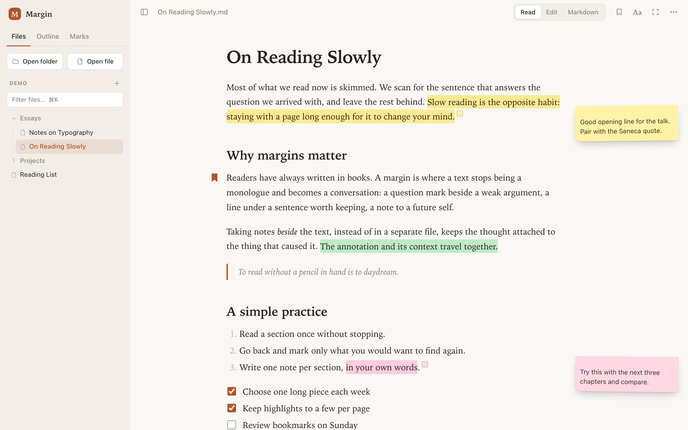
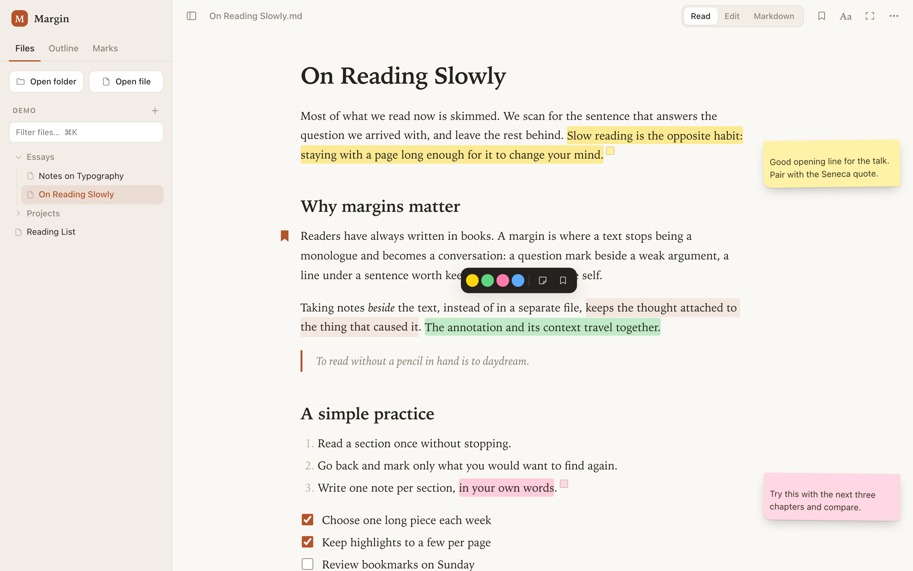
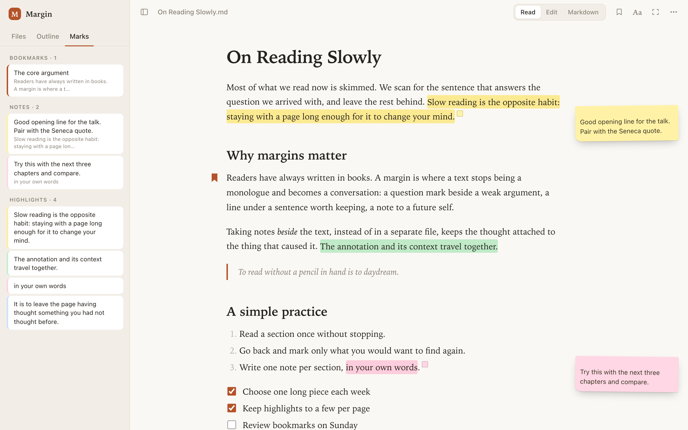
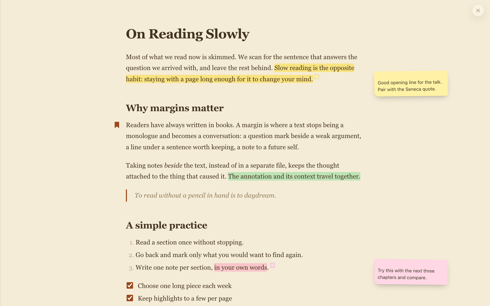
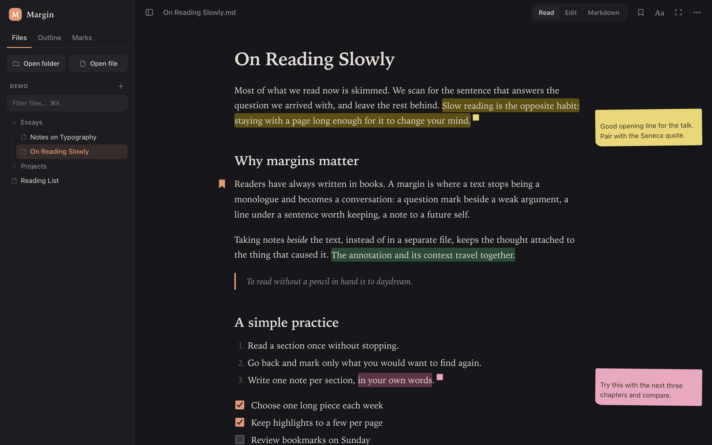
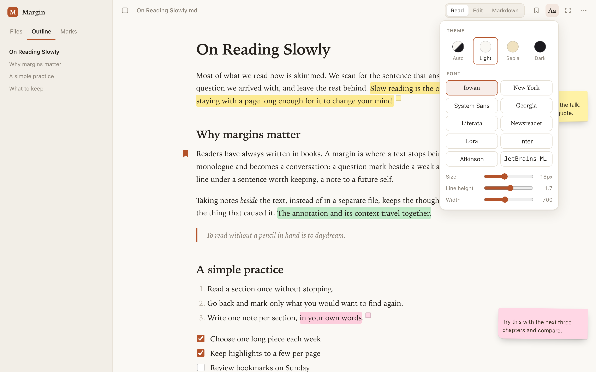
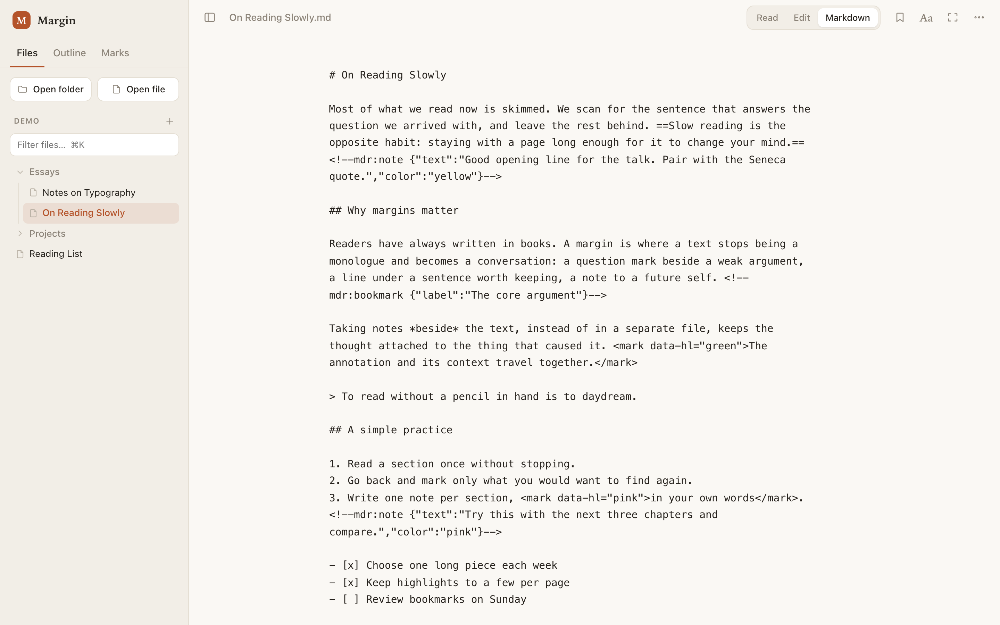

# mdmargin

**Margin** is a lightweight Markdown reader you can also write and annotate in. It ships as `mdmargin`, a single self-contained program: run it on a file or folder and Margin opens in your browser, reading and saving straight to disk.

- One binary of about 7 MB, with no runtime, no dependencies and no account.
- Edit in the rendered page, not only in the source.
- Highlights, sticky notes and bookmarks that live inside the `.md` file, and a one-click clean copy for sharing.
- Runs entirely on your machine. Files are never uploaded.



| | |
| --- | --- |
| **Select text to mark it up**<br>Highlight in four colours, pin a sticky note or drop a bookmark.<br><br> | **Everything you marked, in one place**<br>The Marks tab lists bookmarks, notes and highlights; click one to jump to it.<br><br> |
| **Reading mode**<br>Hides everything but the text. Shown here in the Sepia theme.<br><br> | **Dark theme**<br>Light, Sepia, Dark, or follow the system.<br><br> |
| **Make it yours**<br>Ten typefaces, text size, line height and column width.<br><br> | **It is still plain Markdown**<br>Annotations are stored in the file as `==highlights==` and hidden comments.<br><br> |

## Installation

macOS and Linux:

```sh
curl -fsSL https://raw.githubusercontent.com/BhishitDave/mdmargin/main/install.sh | sh
```

This downloads the latest release for your machine, verifies its checksum and installs it to `~/.local/bin`. Set `MDMARGIN_INSTALL_DIR` to install somewhere else.

Windows, or if you prefer to download by hand: take the binary for your system from the [Releases page](https://github.com/BhishitDave/mdmargin/releases), rename it to `mdmargin` and put it on your `PATH`.

Update to the newest release at any time:

```sh
mdmargin --update
```

Build from source (needs Go 1.25 or newer):

```sh
git clone https://github.com/BhishitDave/mdmargin.git
cd mdmargin
make build
install -d ~/.local/bin && install mdmargin ~/.local/bin/
```

## Usage

```sh
mdmargin                    # open the current folder
mdmargin notes.md           # open one file; its folder becomes the library
mdmargin ~/Documents/notes  # open a folder
mdmargin -port 8080 .       # choose the port (default 4747)
mdmargin -no-open .         # don't launch the browser
mdmargin --version
```

Flags go before the file or folder. The program serves on `127.0.0.1` only, and it will read and write only Markdown files (`.md`, `.markdown`, `.mdx`, `.txt`) inside the folder you opened. Hidden files and folders are never served.

### Without the binary

The app also works as a plain web page: open `web/index.html` in a browser. In that mode, saving back to disk depends on the browser:

| Browser | Open folders | Save back to the file |
| --- | --- | --- |
| Chrome, Edge | Yes | Yes |
| Brave | After enabling `brave://flags/#file-system-access-api` | After enabling the flag |
| Firefox, Safari | Read-only | No; Save downloads a copy instead |

Run through `mdmargin`, saving works in every browser.

## What has been created

### Reading and navigation

- **Folder library**: open a folder and browse every `.md`, `.markdown`, `.mdx` and `.txt` file in a collapsible tree, with a filter box (⌘K).
- **Outline**: headings of the current document, with the current section tracked as you scroll.
- **Marks tab**: every bookmark, sticky note and highlight in the document, each one click away.
- **Reading mode** (⌘.): hides the sidebar and toolbar and leaves only the text.
- **Reading progress** bar, and the scroll position of each file is remembered.
- Drag and drop a file or folder anywhere; the last folder is offered again on the next visit.
- Relative links between Markdown files and relative images work inside an opened folder.

### Editing

- **Edit mode** (⌘E): type directly into the rendered page.
- **Markdown shortcuts while typing**: `# ` headings, `- ` and `1. ` lists, `> ` quotes, ```` ``` ```` + Enter for code blocks, `---` + Enter for a divider.
- **Markdown mode** (⌘/): the raw source, for when you want it.
- **Selection toolbar**: bold, italic, inline code and links.
- Task-list checkboxes can be ticked in any mode.
- **Faithful saving** (⌘S): only the blocks you changed are rewritten. Everything else, including front matter, comments, raw HTML and your own formatting quirks, is written back byte for byte.

### Annotations

- **Highlights** in four colours. Click one to recolour or remove it.
- **Sticky notes** pinned to a passage, shown as paper notes in the margin (or opened from their pin on narrow screens), each with its own colour.
- **Bookmarks** on any paragraph, heading or list item (⌘D), with optional labels.
- Annotations are stored **inside the Markdown file**, so they travel with it:
  - yellow highlight: `==text==`
  - other colours: `<mark data-hl="green">text</mark>`
  - notes and bookmarks: invisible comments such as `<!--mdr:note {"text":"…","color":"yellow"}-->`
- **Clean copies for sharing**: *Save clean copy*, *Copy clean Markdown* and *Remove all annotations* in the ⋯ menu.

### Appearance

- Themes: Light, Sepia, Dark, and Auto (follows the system).
- Ten typefaces: four system fonts that work offline and six loaded from Google Fonts on first use.
- Adjustable text size, line height and column width. All settings are remembered.

### How it is built

| Path | Purpose |
| --- | --- |
| `main.go`, `update.go` | The `mdmargin` program: embeds the web app, serves it locally, exposes a small file API confined to one folder, and self-updates |
| `web/index.html`, `web/styles.css` | Page structure, themes and layout |
| `web/app.js` | All behaviour, in plain JavaScript |
| `web/welcome.js` | The built-in welcome guide |
| `web/vendor/` | marked (Markdown → HTML), Turndown + GFM plugin (HTML → Markdown), DOMPurify (sanitising) |
| `install.sh` | The one-line installer |
| `scripts/build-all.sh` | Cross-compiles every release binary and writes checksums |
| `.github/workflows/` | `ci.yml` tests every push; `release.yml` builds and publishes binaries when a version tag is pushed |

The web app has no framework and no build step. Rendered Markdown is sanitised, so opening an untrusted file cannot run scripts. The local server rejects requests from other websites and cannot be made to read or write outside the opened folder.

## Development

```sh
make test     # Go tests, plus headless tests of the Markdown round trip (needs Node)
make run      # build and open the current folder
make dist     # cross-compile all release binaries into dist/
```

The screenshots above are generated from the demo library in `docs/demo`. To refresh them after a visual change:

```sh
npm i --no-save playwright && npx playwright install chromium
make build && node scripts/screenshots.mjs
```

## Releasing

Push a version tag and GitHub Actions does the rest:

```sh
git tag v0.1.0
git push origin v0.1.0
```

The release workflow runs the tests, builds binaries for macOS, Linux and Windows (Intel and ARM), and publishes them with `checksums.txt` as a GitHub Release. `install.sh` and `mdmargin --update` both pick up the new version automatically.

## How it compares

A fair comparison: each of these tools is better than Margin at something. Margin's niche is the combination of *a tiny install*, *edit in the rendered view* and *annotations that live in the file*.

| | Margin | Typora | Obsidian | VS Code preview | Browser Markdown-viewer extensions |
| --- | --- | --- | --- | --- | --- |
| Install needed | One small binary, or none (open the HTML page) | Desktop app | Desktop app | Desktop app | Extension |
| Cost | Free | Paid licence | Free for personal use | Free | Free |
| Edit in the rendered view | Yes | Yes | Yes (live preview) | No (split source/preview) | No |
| Highlights | 4 colours | `==` single colour | `==` single colour | No | No |
| Sticky notes on a passage | Yes | No | Via plugins | No | No |
| Bookmarks inside a document | Yes | No | File/heading bookmarks | No | No |
| Annotations stored in the file | Yes | Highlights only | Highlights only | n/a | n/a |
| One-click clean copy without annotations | Yes | No | No | n/a | n/a |
| Leaves untouched text byte-identical on save | Yes | Reformats some syntax | Yes (source-based) | Yes | n/a |
| Themes and font controls | Built in | Themes via CSS | Themes and plugins | Editor themes | Varies |

Where Margin is better:

- **Tiny and self-contained.** One binary of about 7 MB with one-line install and update, or no install at all if you open the page directly. It works offline (apart from the optional web fonts).
- **Reading-first annotations.** Coloured highlights, margin sticky notes and in-document bookmarks are built in rather than added through plugins.
- **Annotations are portable and removable.** They are plain text inside the file, readable by any tool, and can be stripped in one click before sharing.
- **Small and hackable.** One HTML file, one stylesheet, one script and two short Go files, with no framework to learn.

Where the others are better:

- **Obsidian**: linking between notes, backlinks, graph view, search across a vault, sync, mobile apps and a very large plugin ecosystem.
- **Typora**: a more mature in-place editor (tables, maths, diagrams, image handling) and export to PDF, Word and other formats.
- **VS Code**: Git integration, multi-file search and replace, and extensions for everything.
- **All three** are mature products with years of polish; Margin is new and lightly tested.

## Known limitations

- Opened as a plain web page (without the binary), saving to disk needs a Chromium-based browser (see the table above).
- The program is not code-signed. Installing with the script or `--update` works; a binary downloaded through a browser may need to be allowed manually on macOS and Windows.
- A highlight cannot start or stop partway through inline code, and code blocks cannot be highlighted.
- *Clean copy* removes every `==text==` highlight, including any you typed by hand.
- Undo (⌘Z) covers typing, but not always highlight, note and bookmark changes.
- No syntax colouring in code blocks, no maths or diagram rendering.
- Search within a document is the browser's own ⌘F.
- Saving is manual; there is no autosave.
- The interface has had automated tests of the Markdown round trip, but only light manual testing so far.

## Future scope

Near term

- Syntax colouring for code blocks; KaTeX maths and Mermaid diagrams.
- Search across all files in the open folder.
- Optional autosave and a "file changed on disk" warning.
- A proper table editor and image paste / drag-in.
- Rename, move and delete files from the tree.
- Tags and a filter on the Marks tab; export of all annotations as a summary document.

Later

- Homebrew, Scoop and winget packages; signed binaries.
- Register as the system opener for `.md` files, so double-clicking one opens it here.
- A browser-extension wrapper that renders any `.md` URL or local file in Margin.
- Print and PDF export with a print-specific layout.
- Custom themes, and fonts bundled for full offline use.
- Wiki-style `[[links]]` and backlinks between files.
- Version history for a document (local snapshots).
- Optional sidecar storage for annotations, for people who prefer the `.md` file untouched.

## Keyboard shortcuts

| Shortcut | Action |
| --- | --- |
| ⌘S | Save |
| ⌘E | Toggle Edit mode |
| ⌘/ | Toggle Markdown source |
| ⌘. | Reading mode (Esc to leave) |
| ⌘\ | Toggle sidebar |
| ⌘D | Bookmark the current spot |
| ⌘K | Filter files |
| ⌘Enter | New paragraph below (the way out of a code block or quote) |

On Windows and Linux, use Ctrl in place of ⌘.

## License

MIT. See [LICENSE](LICENSE) and [THIRD_PARTY_NOTICES.md](THIRD_PARTY_NOTICES.md).
